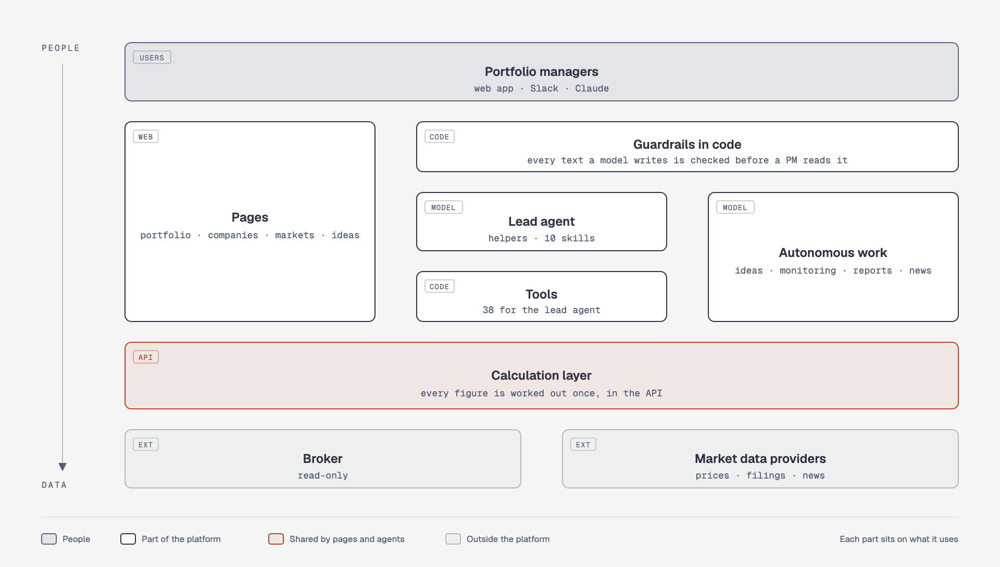
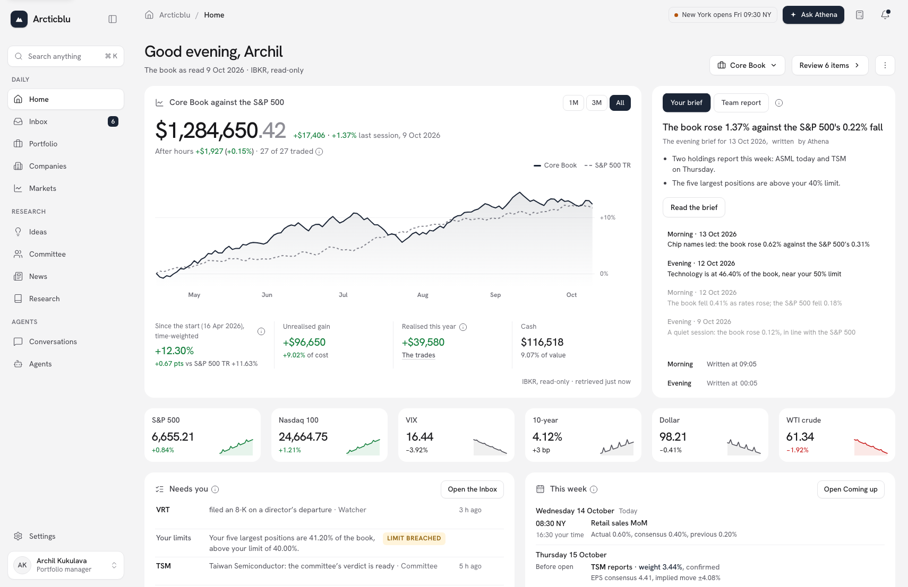
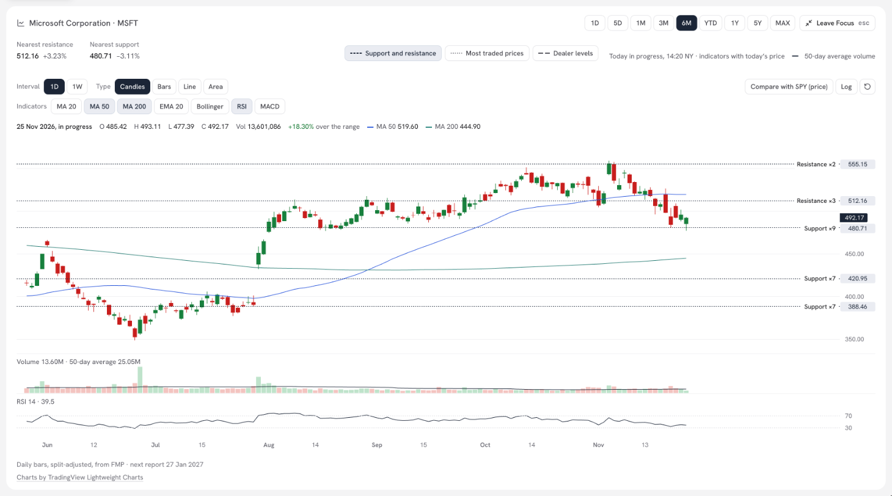
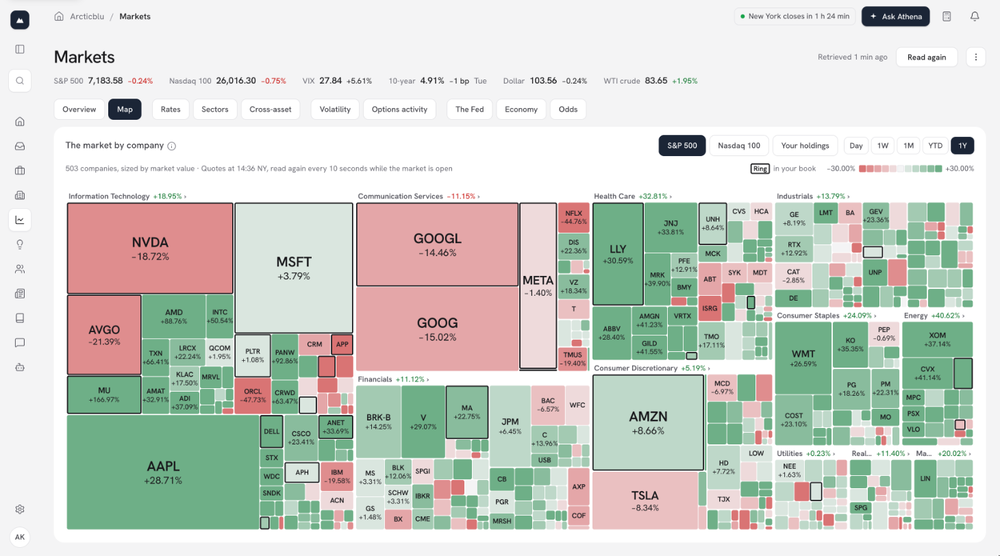
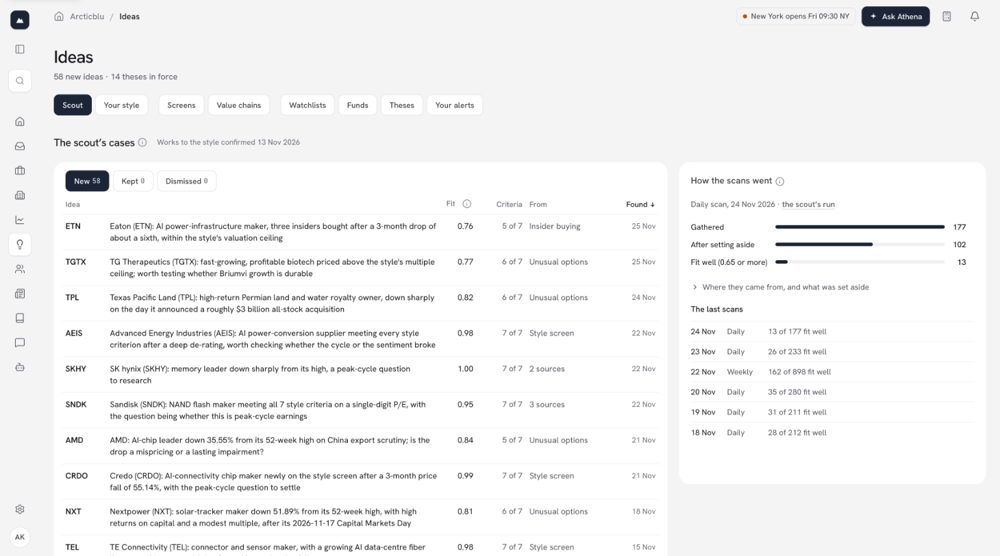
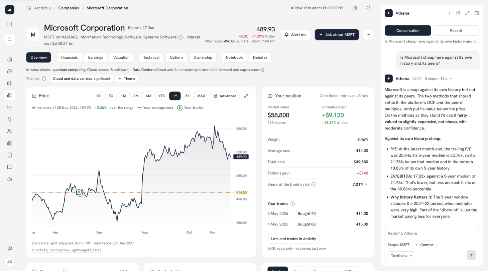
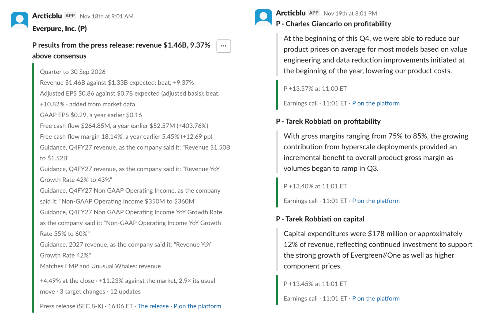

# Arcticblu-OS

**A production multi-agent investment platform built with my own agent meta-harness.**

I designed and built Arcticblu-OS, the operating system of ArcticBlu Capital. The firm's portfolio managers run their
day on it: their book, risk and returns read live from the broker, company research, markets, ideas, news, scheduled
reports, and an agent they question from the web app, from Slack and from inside Claude.

The source is private, because it holds the firm's methods and data. This repository documents its architecture and
its measured results.

| | |
|---|---|
| **In production** | Used every day by the firm's investment team |
| **Autonomous work** | Agents source ideas, read every filing and results release, watch each thesis for a break, and write the briefs and reports |
| **Agents** | 6 agent types, 10 skills, 38 tools |
| **Reach** | Web app, Slack, and a remote MCP connector with OAuth 2.1 that serves the agents' question tools inside Claude |
| **Code** | A FastAPI and Postgres API and a Next.js web app |
| **Tests** | API tests, scripted browser walks, a fixed agent eval suite, a nightly agents-against-pages check |

## Architecture

Agents and pages read the same calculation layer, so a figure an agent quotes is the figure the page shows. Guardrails
in code check every answer, which is what lets the agents work on their own. A steward in plain code
watches health, cost and correctness and repairs routine faults by itself.

## What it looks like

Portfolio figures are invented. Company, market and Slack data are real, from the live platform. Each picture opens at full size.

<b>Home.</b> The portfolio manager's start of day, with the book against the S&P 500, the agent's brief and what needs attention.

<table>
<tr>
<td width="50%" valign="top"> <b>Chart.</b> Microsoft's daily candles with moving averages, volume and RSI, and the support and resistance levels the platform found.</td>
<td width="50%" valign="top"> <b>Market map.</b> The S&P 500 over one year, each company sized by market value.</td>
</tr>
<tr>
<td width="50%" valign="top"> <b>Idea sourcing.</b> The nightly scan for new ideas, with candidates ranked by fit to the portfolio manager's style and a reason for each.</td>
<td width="50%" valign="top"> <b>The agent beside every page.</b> Athena answers a question on Microsoft's valuation beside the company's own page, with the verdict first and the evidence after.</td>
</tr>
</table>

Everpure's results against consensus with its guidance, and quotes from the earnings call as replies.

**[The full gallery](GALLERY.md)** has more: the platform's pages, the agents at work, and the messages in Slack.

## How it works

- **[The agent system](docs/agent-system.md).** Each portfolio manager has their own lead agent, which briefs
  helper agents for reading and analysis. Its tools call the same code that renders the pages. An agent loop runs
  where the steps are unknown.
- **[Autonomous work](docs/autonomous-work.md).** The agents do most of their work autonomously. They watch the market and
  each portfolio manager's book and act on what happens, from a new filing to a broken thesis.
- **[The news system](docs/news-system.md).** Each portfolio manager is told in Slack what matters to their book, as
  it happens: news, results, filings, analysts' calls, insiders' trades, unusual moves. Written rules and a model
  decide what is worth a ping, what is sent quietly and what stays off Slack.
- **[Evals](docs/evals.md).** Any change to an agent's instructions, tools or model is measured before it reaches a
  portfolio manager. Two versions are compared blind by judges from two model families.
- **[Guardrails in code](docs/guardrails.md).** Code prints each figure in an answer from the tool result it came
  from, and a check sends an untraced answer back to the agent.
- **[Monitoring, cost and human control](docs/operations.md).** The platform runs unattended, with a steward in
  plain code that watches it and repairs routine faults by itself. Spending is capped at every level, from one turn
  to the month. A portfolio manager confirms what is theirs to decide, such as an alert or a portfolio view.
- **[The meta-harness](docs/meta-harness.md).** The platform is built by AI coding agents inside my own
  meta-harness, a fixed process of six stages with skills and instructions loaded for the task at hand. I approve
  each written spec once, and agents then build, test and review it without me.

## What is public here

- **Public:** the architecture, the measured results, pictures of the live platform, and the
  [research](docs/sources.md) behind the design.
- **Private:** the source code, the firm's methods and its data. Portfolio figures in the pictures are invented.
- **My part:** I designed the platform, its agents, its evals and the meta-harness that builds it, and I decide
  what is built.
