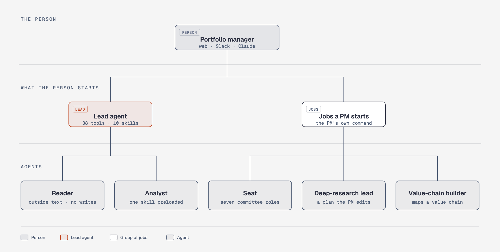
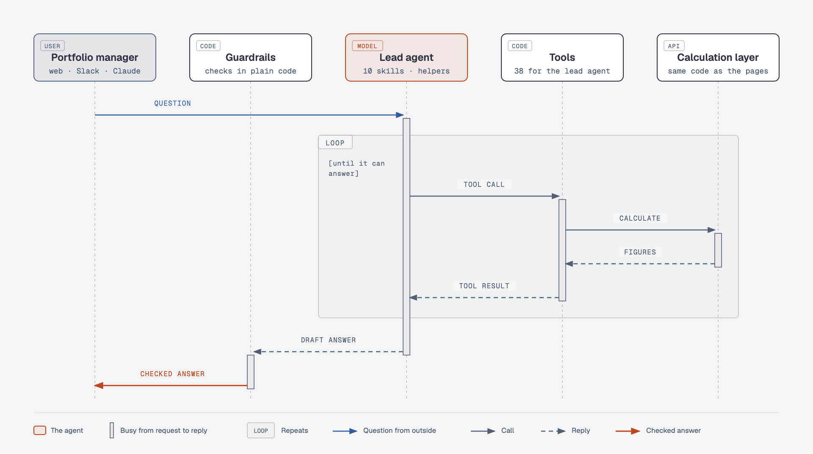

# The agent system

Each portfolio manager (PM) works with **their own lead agent**, which opens skills on demand and briefs helper agents.

- **Six agent types.** The PM's agent leads. A Reader opens outside text. An Analyst runs with one skill
  preloaded. A Seat plays seven committee roles (Bull, Bear, Quality, Valuation, Risk, Style, Pre-mortem). A
  deep-research lead and a value-chain builder cover the long jobs.
- **Agent loops where the steps are unknown.** Everything with a fixed shape (report writers, rule verdicts,
  filing notes) is one structured model call, with code gathering the inputs before it and filing the
  result after.
- **Tools are shaped as questions.** No two tools overlap. Each calls the same function that renders the page, so an
  agent and a page cannot disagree.
- **One shape for every tool result.** Labelled figures with unit, basis, period and as-of date, plus the
  comparisons the question needs (rank, "x of n", larger of two, gap, day counts) already worked out in code.
- **Skills by progressive disclosure.** The agent sees a one-line index and opens a skill as a tool result, after
  the cached prefix, so loading knowledge never breaks the prompt cache.
- **Committee seats work apart.** They run in parallel, in clean contexts, and one synthesis call reads what
  they filed.
- **Context management for long conversations.** Old tool results are cleared in large, infrequent batches, so a
  long conversation stays inside the model's window and keeps its prompt cache.
- **A calculator tool does all the arithmetic.**
- **Lean instructions.** Each ends on a checkable condition for "done", each rule lives in one place, and a line
  the model already follows by default is deleted. Tests enforce these rules.
- **Prompts are versioned.** Every model step records a hash of the exact instructions it ran on.

**How a question is answered**

**Outside the platform**

- **In Slack.** A PM messages the app or mentions it in a channel, and their own agent answers in the thread
  through the same checks as on the platform.
- **Inside Claude.** A remote MCP connector with its own OAuth 2.1 sign-in hands Claude the same question tools,
  run by the same code.

These decisions were informed by [research](sources.md) and tested on the platform's own [evals](evals.md).

[Back to the overview](../README.md)
