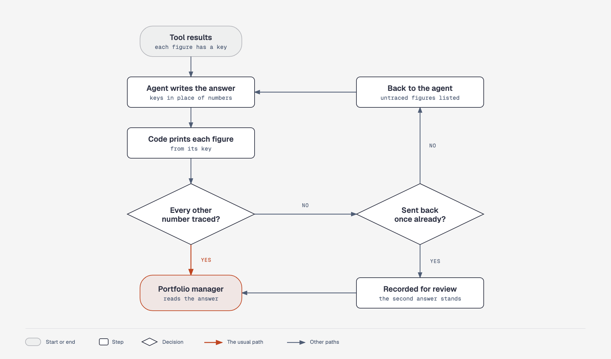

# Guardrails in code

Guardrails in code are what let the agents work on their own, without constant supervision. Code checks every
figure and every quote before an answer reaches a portfolio manager (PM).

**The path of an answer**

**Figures by reference.** The model never types a number. Every figure in a tool result carries a key, such as `f12`. The agent
writes the key in place of the number, and code prints the value. The model cannot copy, round or mistype a figure.

**Every figure traced.** Before any text reaches a PM, each remaining number is traced to a tool result. Another
agent's words and web pages never count as a source. An untraced number sends the answer back to the agent once.
The check never blocks an answer, and logs any number it still cannot trace for review.

**Quotes verified word for word.** The Reader, the agent that opens outside text, answers in an
API-enforced schema. Code keeps the passages found
verbatim in the text it read, and blanks any source that does not itself contain the passage.

**Privilege separation against prompt injection.** The agent that reads outside text holds no write tool. The
agent that holds writes never sees raw outside text. Once quoted outside text enters a task, every write becomes a
card the PM must confirm. A test enforces this over the whole set of agents and tools.

**Agents and pages must show the same number.** A nightly check on production data compares every figure an agent
can be handed against the figure the page shows, and scans for a fraction where the page
shows a percent, a missing currency or a stale date. A new figure that agents see and no page shows fails the run
until it is reviewed. The same check runs before every deploy.

**Read-only for money.** The broker's tool server is reached through an exact-name allow-list of
read tools, each pinned to a fingerprint of its input schema. A tool the broker changes is refused until a
person reviews it, and the broker's tool list never reaches the model.

[Back to the overview](../README.md)
