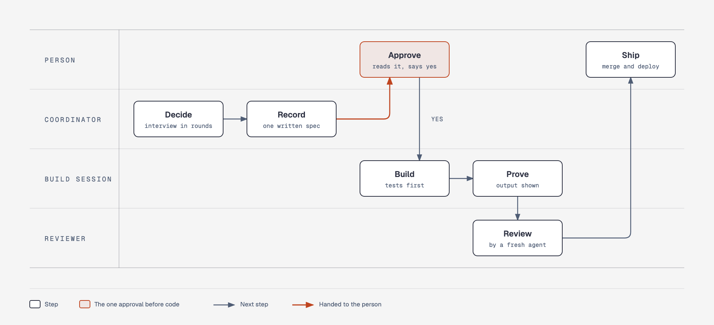

# The meta-harness

The platform is built by AI coding agents working inside a second agent system that I designed.
This meta-harness is the layer of instructions, skills, hooks and settings added on top of a coding agent. I treat
it as a product, with the same parts as the platform's agents: defined roles, a fixed pipeline, guardrails
enforced in code, one human approval point, and its own measurements. I describe what I want in a sentence, and
coding agents take it to tested, deployed software. A person decides, and the rest is automated.

## The process

The stages were informed by [research](sources.md) and are measured in use. A build session takes the approved
spec and returns it built, tested and reviewed.

### Three sizes of work

| Size | It is | It goes through |
|---|---|---|
| **Small** | a fix that fits in a sentence; docs; tooling | fix, run its check, show the result, commit. No spec, no review |
| **Normal** | one piece that fits one session | the six stages below, once: decided and recorded with the human, built in a fresh session |
| **Large** | more than one session can hold | split into tickets first; then each ticket runs as Normal, in its own fresh session |

### The six stages

| Stage | Done by | What happens |
|---|---|---|
| 1. Decide | the coordinator, with the human | an interview in rounds, every question with a recommended answer, until the human confirms |
| 2. Record | the coordinator | one written spec: the proposal, what will be true when it ships, and its tasks. **The human reads it and says yes: the one approval before code** |
| 3. Build | a build session | tests first at the seams, the full suite once at the end, tasks ticked as it goes |
| 4. Prove | the build session | no "done" without the command run and its output shown; what was not checked is said |
| 5. Review | a reviewer that did not see the build | once; a finding is checked against the code before it is acted on |
| 6. Ship | the human | a merge and a deploy at the human's word; the spec is archived |

## What each task loads

The six stages are the same for every piece of work, and each session loads on top of them what its task
calls for. A sources map indexes the skills, guidance and documentation the work draws on, by the kind of task
each one serves.

| The task | Loaded for it |
|---|---|
| A new feature | Skills for designing its modules, and the product's rules for the area it touches |
| Work on the agents | Guidance on agents, tools and context, and the agents' eval suite |
| A new page | The design skills and the product's design system |
| A fault | A diagnosis skill that finds the cause before the fix |

## Guardrails in code

A rule with no exceptions is enforced by code, which lets a session run unattended: agents cannot change
production, a deploy that contains a secret is refused, and a failed design check sends the agent back to work.

## Work across sessions

- **One ticket per fresh session.** One coordinator, the conversation I talk to, holds stages 1, 2 and 6. It
  starts a session for a ticket with one message, because the spec is the brief.
- **No work is done twice.** The coordinator does not re-brief a session, re-run its checks or review its work.
  Splitting one piece of work by role loses detail at every handoff, so work is split into whole independent
  tickets that can run side by side.
- **The state lives in three places:** the ticked tasks of each spec, git commits with descriptive
  messages, and a plan file in the repository that says what is in flight and what comes next. A summary can drop a
  detail, so the state is never left to a conversation.

## Measured like a product

Rules and checks pile up, and as models improve many of them become dead weight that still costs speed, accuracy
and tokens. I measure each piece and remove the ones that no longer catch real faults or save time.

- **Where the time goes.** Each piece of work is timed from git history.
- **What each check catches.** Every failure of the test suite, the browser walks and the agents-against-pages check
  is classed as a real fault or a false alarm, and a check that mostly raises false alarms is moved or removed.
- **What each rule earns.** A rule is added after the same mistake happens a second time, and a line the agent can
  work out by reading the code is removed.

[Back to the overview](../README.md)
