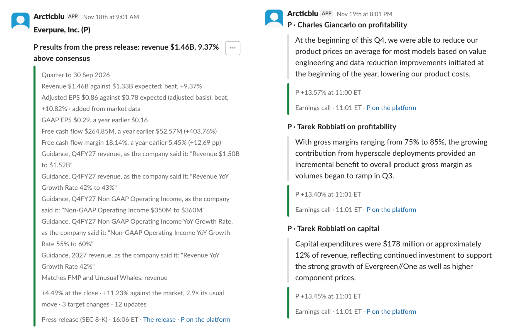
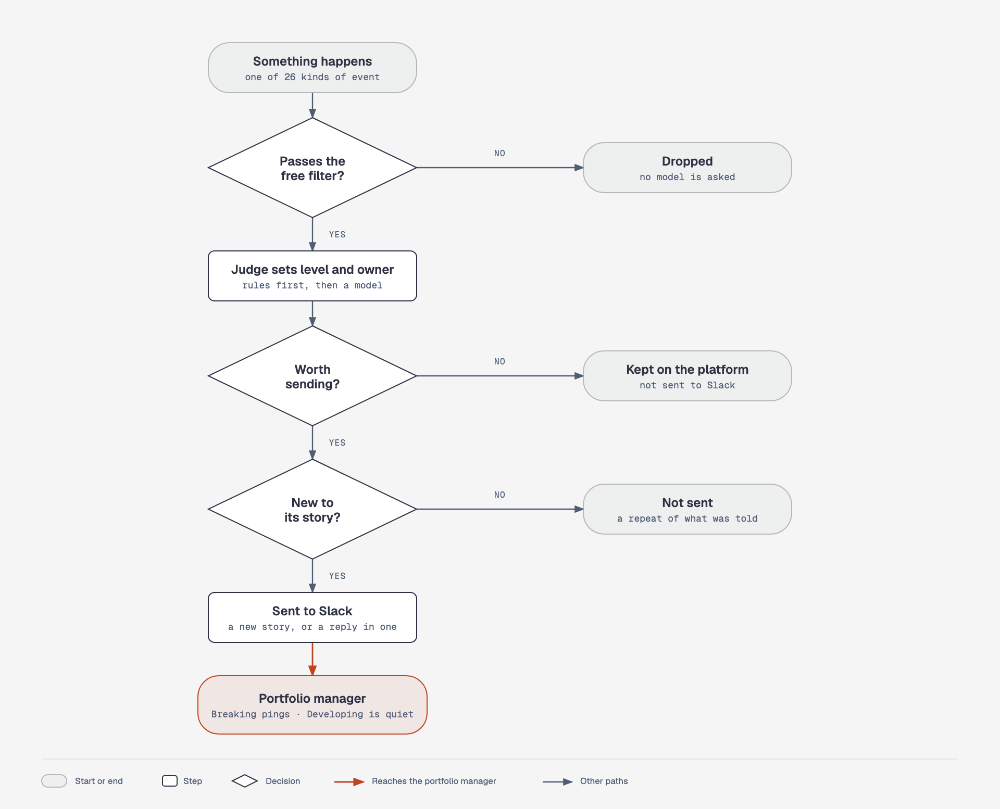
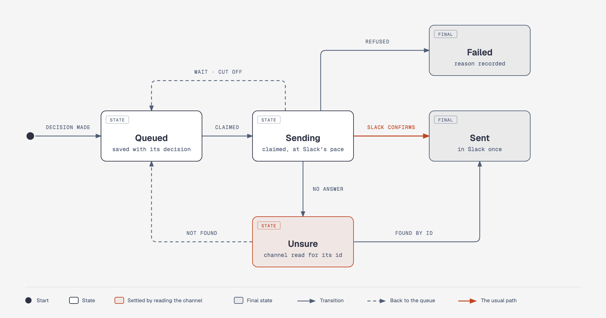

# The news system

The news system tells each portfolio manager (PM) in Slack what matters to their book as it happens, and keeps
everything else quiet.

Everpure's results against consensus with its guidance, and quotes from the earnings call as replies.

## What a portfolio manager gets

- **Channels of their own.** Each PM has a private channel for news on their holdings and watchlists, and a second
  one for the platform's own work, such as reports and alerts that were met. Market-wide news goes to a channel
  the team shares.
- **Three levels.** Breaking is sent at once and pings the PM by name. Developing is sent at once without a ping,
  so a ping always means "look now". Record is kept on the platform and never sent.
- **One event is one story.** An event is one message, and each new development on it arrives as a reply in its
  thread. A PM is pinged once for an event, however many developments follow.
- **Mute.** "Mute this story" stops one story's pings for one PM, with an Undo.
- **A delivery record.** A page lists every message sent to the PM and whether it arrived.

## What decides that something is worth telling

What is not worth telling leaves at one of three points.

- **26 kinds of event through one entrance.** The rest of the platform hands the news system what happened and the
  time, and the news system decides the level, the channel, the story and who is pinged.
  - *News:* articles and press releases, read every minute, nights and weekends included.
  - *Company events:* results releases and quotes from the call, filings, analysts' actions, dividend changes,
    FDA decisions, trading halts.
  - *Alternative data:* insiders' trades, trades by members of Congress, unusual options activity, the
    President's posts, jumps in prediction-market odds.
  - *Markets:* economic releases with the market's reaction, and unusual moves of a company, the PM's book or the
    market.
  - *The platform itself:* a breached limit, a finished report, a failure.
- **A free filter for articles, before any model is asked.** It drops an article by the form of its headline or by
  its outlet, such as a question with no news in it, a list of stocks to buy or an advert. On one real day's
  articles it removed a third and kept every item that the PM and two blind labellers had marked as worth telling.
- **Written rules for each kind of event.** A price move, for example, is measured against that company's own
  usual move after the market's part is taken out, and one outside regular hours needs a second reading before it
  pings.
- **A model for what rules cannot settle.** It is asked single questions with fixed answers, such as whether
  an article reports the same event as an open story. Analysis, opinion and retellings are never sent.
- **Grouping articles into events is measured.** On labelled real pairs held out from tuning, it reached precision
  0.91 and recall 0.88, against 0.56 for a simple rule.
- **Messages are built by code.** A story's message is built from stored state, with every figure from the same
  functions as the platform's pages.

## Each message arrives exactly once

Slack's API has no way to say "send this once", so a call that times out leaves the sender not knowing whether
the message landed. Sending again risks a double and holding back risks a miss. The delivery design removes both
risks.

- **A decision and its message are saved together.** Each message is written in the same database transaction as
  the decision that made it, so one cannot exist without the other.
- **A message is claimed before it is sent.** Two processes running at once, as during a deploy, cannot send the
  same message.
- **Every message carries its own id inside Slack.** When a send gets no answer, or the sender is cut off in the
  middle of a call, the channel is read for that id and the message is sent again if it is not there.
- **Slack's rate limit holds across processes.** Each send takes the next free second for its channel from the
  database in one step.

[Back to the overview](../README.md)
